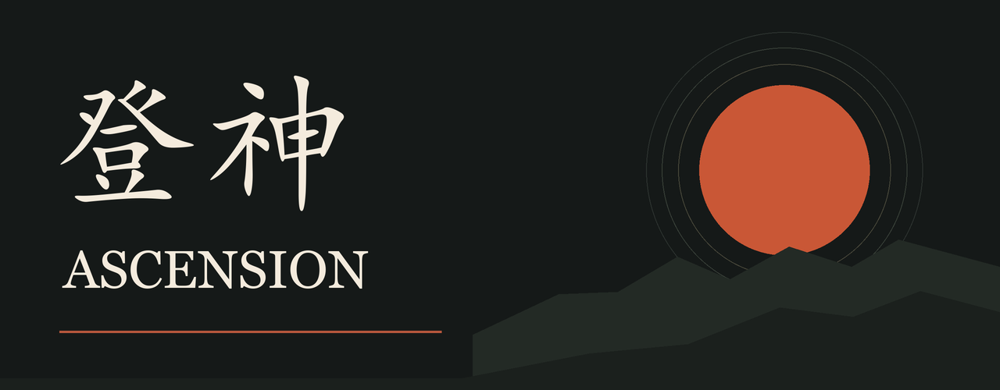

[中文](README.md) · [English](README.en.md)

# ASCENSION《登神》

**Human evolution is still underway.**

> The first tool revolution put tools in our hands.\
> The second lets us act through tools by expressing intent.

A sentence can set software, instruments and machines to work. ASCENSION asks what people can do with those tools today, and what it will take to put the same abilities within reach of more people.

[**Manifesto**](MANIFESTO.en.md) · [**Technology atlas**](atlas/README.md) · [**Forecasts**](predictions/README.md)

## What is changing

- **Mathematicians can work with models to find proofs.** Levent Alpöge developed a proof of the Riemann hypothesis with Claude. The Lean community checked the formal proof. A working draft explaining it appeared on 22 November. [Research agents](atlas/intelligence/research-agents.md)
- **A warehouse robot is doing real work.** GXO and Agility report that Digit moved over 100,000 totes at one facility. The next test is whether it can repeat the work at new sites. [Warehouse deployment](atlas/execution/agility-robotics.md)
- **A brain interface has reached a specific rehabilitation use.** China registered an implantable system for hand-movement compensation. The evidence to watch is whether people keep using it and continue to benefit. [Neural interfaces](atlas/life/neural-interfaces.md)

The atlas and forecast notes are primarily in Chinese, with English summaries in the atlas.

[November field notes](atlas/2026-11.md) · [Primary sources](REFERENCES.md) · [Contribute](CONTRIBUTING.md)
