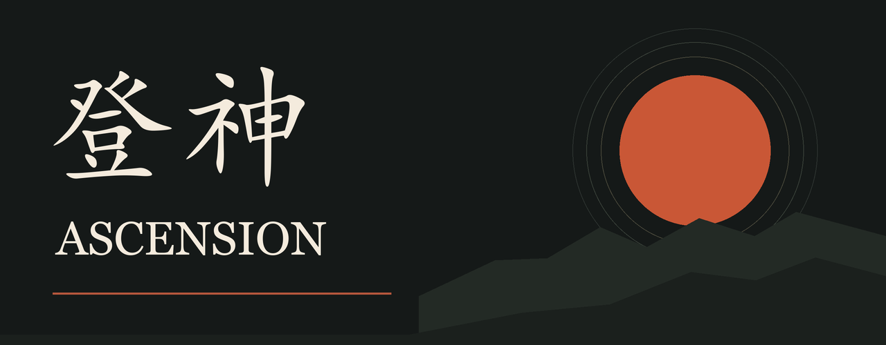

[中文](README.md) · [English](README.en.md)

# ASCENSION《登神》

**人的进化尚未结束。**

> 第一次工具革命，人凭身体使用工具。\
> 第二次工具革命，人凭意图使用工具。

一句话已经能调动软件、仪器和机器。《登神》追问这种变化会给人带来什么能力，又要怎样才能让更多人拥有它。

[**思想宣言**](MANIFESTO.md) · [**产业地图**](atlas/README.md) · [**预测账本**](predictions/README.md)

## 正在发生的变化

- **数学家可以和模型一起寻找证明。** Levent Alpöge 与 Claude 合作提出的黎曼猜想证明通过了 Lean 社区的形式化核验。11 月 22 日出现了一份可读的解释草稿。 [科研代理](atlas/intelligence/research-agents.md)
- **仓库机器人开始承担实际作业。** GXO 与 Agility 披露，Digit 已在一个仓库搬运超过十万只周转箱。它能否在新站点重复这项服务，是下一步检验。 [仓库作业](atlas/execution/agility-robotics.md)
- **脑机接口走进特定康复场景。** 中国药监部门已注册一款植入式手部运动功能代偿系统。接下来要看患者能否持续使用并获益。 [脑机接口](atlas/life/neural-interfaces.md)

[11 月观察](atlas/2026-11.md) · [原始资料](REFERENCES.md) · [参与研究](CONTRIBUTING.md)
