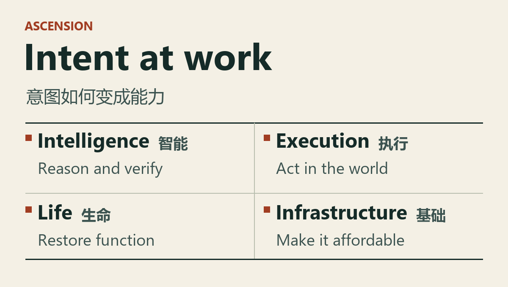

[首页](../README.md) · [English home](../README.en.md) · [预测](../predictions/README.md)

# 产业地图 / Technology Atlas

人提出目标，系统理解并执行，人能观察结果并调整行动。生命技术修复或延长承载这些能力的身体。基础设施决定这些变化可以服务多少人、以什么成本提供。

## Intelligence · 智能

**[科研代理与 Anthropic](intelligence/research-agents.md)**\
从形式化数学到自动化实验室。看重可复现结果、交付成本和固定任务上的可靠性。\
*Proof verification, research agents, and what Claude customers pay for.*

## Execution · 执行

**[Agility Robotics 与 GXO](execution/agility-robotics.md)**\
付费仓内作业、跨站点部署和单位经济性。把车队与固定自动化作为比较对象。\
*Paid tote handling, site replication, and service economics.*

## Life · 生命

**[临床脑机接口](life/neural-interfaces.md)**\
从注册适应症、实用任务到连续使用。比较植入、非植入和共享自治。\
*Regulatory scope, useful actions and sustained benefit.*

**[药物发现、器官替换与细胞修复](life/repair.md)**\
用人体试验和实际终点区分研发服务、候选药物和可购买的疗法。\
*Drug discovery, organ replacement, cellular repair and the evidence needed for each.*

## Infrastructure · 基础设施

**[NVIDIA 与云厂商现金支出](infrastructure/nvidia.md)**\
观察系统集成、替代芯片和现金流，用估值反推价格所要求的增长。

**[TSMC 与先进制造](infrastructure/tsmc.md)**\
分开观察先进节点、封装、实际资本投入和产能兑现。

[查看 11 月观察](2026-11.md) · [Anthropic 上市与经营分析](intelligence/anthropic.md)

## 收录与比较

档案优先覆盖已有可查物证、处在关键瓶颈且有可验证竞争路径的案例。方向重要而证据还薄的公司放在相应章节的观察名单里。横向比较时使用同质口径，例如每班自主完成任务数、每个试验终点、每美元合格任务。订单、融资、收入、获批和实际使用分别记载。资料入口见[证据索引](../REFERENCES.md)。
