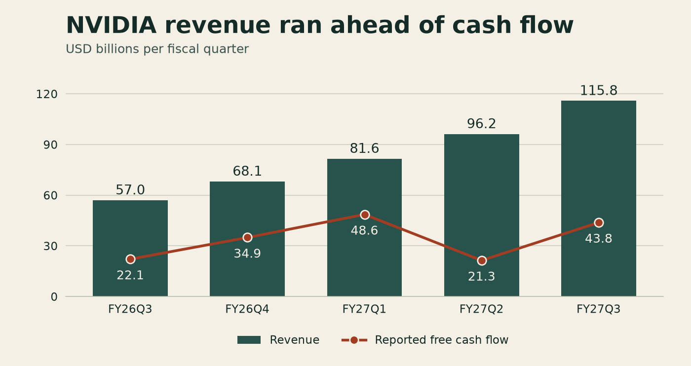

[产业地图](../README.md) · [TSMC](tsmc.md) · [模型输入](../../data/valuation.json)

# NVIDIA 的系统溢价值多少钱？

*The quoted price leaves room for substantial growth, and assumes the economics of the integrated system survive competition from in-house accelerators.*

## 客户为什么付费

买家部署 GPU、互连、网络和开发栈组成的系统。训练要让多块卡协作，推理要同时管理吞吐、延迟、显存和电力。客户为更快上线、更多兼容工作负载和更小的集成成本付费。CUDA、机架级工程和网络互相强化。规模也带来约束，包括交付时的配套能源、机房、上游制造和客户融资。

FY27Q3 数据中心收入 **107.6** 十亿美元，约占总营收 **93%**。三家直接客户各占总营收 **14%、11%、11%**，直接客户可能是集成商或分销商。Q3 公司报告 Vera Rubin 机架开始出货，若要判断其下一个季度的供给能力，还要看客户是否上线并承载实际负载。下一季度营收指引 **130.0 ± 3%** 十亿美元，未假设中国数据中心计算收入。 [FY27Q3 财报](https://investor.nvidia.com/news/press-release-details/2026/NVIDIA-Announces-Financial-Results-for-Third-Quarter-Fiscal-2027/) · [SEC 补充资料](https://www.sec.gov/Archives/edgar/data/1045810/000104581026000088/supplementalfinancialinfor.htm)。

已披露的交易方向有两种。NVIDIA 宣布以约 **129.3 亿美元**收购 Hugging Face 的协议，闭环需要看到交易完成和开发者生态的后续行为。Groq 公布的是推理技术非独家授权和人员加入。各自可能影响模型分发和推理成本。SEC 文件记载，2026-11-22 董事会恢复黄仁勋职务，11-23 披露。股价在 11-20 收于 125.53 美元，11-23 为 165.05，11-24 为 155.38。该窗口记录价格变化，无法单独识别治理事件的贡献。 [Hugging Face 协议](https://blogs.nvidia.com/blog/nvidia-to-acquire-hugging-face/) · [Groq 条款](https://groq.com/newsroom/groq-and-nvidia-enter-non-exclusive-inference-technology-licensing-agreement) · [CEO 离任披露](https://www.sec.gov/Archives/edgar/data/1045810/000104581026000082/nvda-20261111.htm) · [复任 8-K](https://www.sec.gov/Archives/edgar/data/1045810/000104581026000090/nvda-20261122.htm) · [Nasdaq 报价数据](https://api.nasdaq.com/api/quote/NVDA/historical?assetclass=stocks&fromdate=2026-11-19&todate=2026-11-24)。

## 一年的营收和现金流

截至 2026-10-25 的四季度，收入 **361.8**、GAAP 净利润 **226.3**、公司口径 FCF **148.6** 十亿美元，FCF 率 **41.1%**。净利包含证券公允价值变化，现金流也受营运资本时点影响。Q2 在销售增长的同时，FCF 从 **48.6** 降到 **21.3** 十亿美元，Q3 又回到 **43.8**。公司 FCF 定义为 CFO 减相关资产采购和本金支付。各季期末、披露日期和原始现金流字段见数据表。 [季度时间序列](../../data/nvidia-quarterly.csv) · [FY27Q2 财报](https://investor.nvidia.com/news/press-release-details/2026/NVIDIA-Announces-Financial-Results-for-Second-Quarter-Fiscal-2027/)。

### 客户的支出怎样传到供应商

| 截至 2026-09-30 的季度 | USD bn | 披露口径 |
| --- | ---: | --- |
| Amazon | 77.26 | 现金流表购置物业与设备总额。[财报](https://ir.aboutamazon.com/news-release/news-release-details/2026/Amazon-com-Announces-Third-Quarter-Results/) |
| Alphabet | 51.40 | 公司披露资本开支。技术基础设施投入中约 65% 属于服务器和网络设备。[电话会](https://abc.xyz/investor/events/event-details/2026/2026-Q3-Earnings-Call-2026-Ujou16CTw9/default.aspx) |
| Microsoft | 39.37 | FY27Q1 现金流表添置物业和设备。[财报](https://www.microsoft.com/en-us/Investor/earnings/FY-2027-Q1/press-release-webcast) |
| Meta | 34.91 | 含融资租赁本金。[SEC 附件](https://www.sec.gov/Archives/edgar/data/1326801/000162828026066700/meta-09302026xexhibit991.htm) |

Amazon 的 2026 现金开支指引约 2200 亿美元、Alphabet 指引 1950–2050 亿、Meta 指引 1350–1450 亿，时间与口径见[可下载数据](../../data/capex.csv)。需要进一步拆出土地、网络、设备和租赁，也要识别云商向第三方购置与自用。Alphabet 披露面向外部客户交付 TPU 系统时，现金先花在备货，之后才收回货款。TPU、其他定制芯片和 AMD 的可替代份额增加时，行业需求和 NVIDIA 收入可以走出不同曲线。

## 股价要求什么

Nasdaq 11 月 24 日收盘 **$155.38**。按最近可核验的 SEC 封面时点股数 **241 亿股**估计，市值 **3.745 万亿美元**。这个股数截至 8 月 21 日，回购会使结果漂移。按 10 月 25 日现金及可交易债券、股票减有息债务净额 **653.6 亿美元**，经营价值约 **3.679 万亿**，约 **24.8 倍**当期公司 FCF。GAAP P/E 约 **16.6 倍**，投资收益使它更难视作经营现金的倍数。 [Nasdaq 收盘序列](https://api.nasdaq.com/api/quote/NVDA/historical?assetclass=stocks&fromdate=2026-11-19&todate=2026-11-24) · [股数来源](https://www.sec.gov/Archives/edgar/data/1045810/000104581026000075/nvda-20260726.htm) · [资产负债表](https://investor.nvidia.com/news/press-release-details/2026/NVIDIA-Announces-Financial-Results-for-Third-Quarter-Fiscal-2027/)。

用滚动十二个月收入作起点，向前滚五个年度。经营现金流用「年度收入 × 经常性经营现金率」近似，现金率为扣投资、税及股权报酬经济成本后的情景假设。按折现率逐年折现，终值用下一年现金流除以折现率与长期增速之差。加回前述净流动金融资产得到股权价值。未计非流动股权投资，历史公司 FCF 为模型校准点。用全年现金率近似竞争、再投资、营运资本和激励费用，对股价只有情景解释力。

| 情景 | 未来五年收入增速 | 经营现金率路径 | 折现率 / 永续增速 | 每股估值 |
| --- | --- | --- | --- | ---: |
| 压缩 | 25% → 10% → 6% → 4% → 3% | 34% 逐步降至 26% | 12% / 2% | $60.51 |
| 基准 | 42% → 25% → 16% → 10% → 7% | 40% 逐步降至 36% | 10.5% / 3% | $153.22 |
| 系统溢价 | 53% → 35% → 24% → 16% → 10% | 44% 逐步降至 41% | 9.5% / 3.5% | $282.15 |

基准的第一年增速低于 Q3 的同比增长，以最近四季收入和当前出货进度为起点，随后因收入基数、交付能力和自研推理芯片竞争调低。36% 的成熟现金率低于当前 FCF 率，预留竞争、持续投资和激励成本。压缩情景假设专用硬件重点夺走成熟推理工作负载，系统溢价情景假设机架与网络继续提高单客户贡献。折现率是风险敏感参数，未把同行倍数当作目标。

在基准折现率和长期增速下，若五年都能维持 **36%** 现金率，当前价格对应五年营收每年约 **21%** 增长。若现金率只有 **30%**，要求约 **26%**。终值占基准经营估值的 **72.5%**。即使季度营收仍增长，资本成本上升或成熟现金率下修也足以改变价格。运行 `python data/valuation.py` 可复算反推、三案和敏感性。 [输入](../../data/valuation.json) · [计算](../../data/valuation.py)。

## 接下来怎样验证

未来几个月先看 Rubin 在客户侧的生产上线、存货、交付能力和财报兑现。过去五季的数据中心收入逐季上行，但最新披露未提供可比的客户订单积压总额。公司购买义务、客户意向与已确认收入在不同方向上形成现金承诺。不可从云厂预算反推对 NVIDIA 的已签订单。

模型基准第三年的年度营收约 **7450 亿美元**，比起点多约 **3830 亿美元**。这是对 NVIDIA 可确认收入的情景要求；云厂资本开支、芯片、机架与云服务收入有供应链重叠。短期若财报仍增长而交付推迟，先观察营运资本和采购承诺。中期若两季出现数据中心收入低于约 20% 同比增速、且正常化现金率低于 30%，基准失去支撑。也看 Alphabet 的 TPU 外供、客户自研和 AMD 是否获得真实生产负载。股价可以提前反映这些变化，营收拐点往往要等已有合同和交付消化后才出现。
